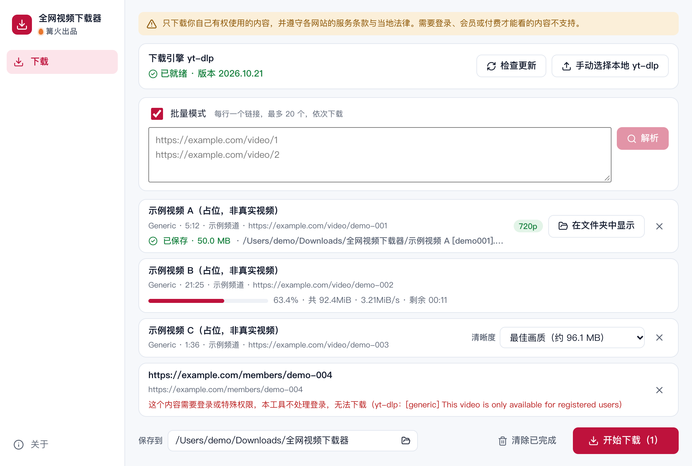

# 全网视频下载器

> 篝火出品 · 收录于篝火 App 应用区

> [!WARNING]
> 本工具涉及第三方平台的自动化或内容获取，存在账号被限制、违反平台规则或侵权的风险，仅供学习研究。请遵守平台规则与法律法规，使用后果自负。
>
> **只下载你自己有权使用的内容**（自己的作品、已获授权、公有领域、允许下载的内容），并遵守各网站的服务条款。本工具不处理账号登录，不读取浏览器 Cookie，需要登录、会员或付费才能观看的内容不支持。

粘贴视频链接，选择清晰度，下载到本地。下载核心是开源的 yt-dlp，支持它所支持的网站（具体列表见 [yt-dlp 支持的网站](https://github.com/yt-dlp/yt-dlp/blob/master/supportedsites.md)）；合并音视频使用安装包内置的 ffmpeg。



## 下载

到 [Releases](https://github.com/campfire-code/video-downloader/releases/latest) 下载对应安装包：

| 电脑 | 文件 |
|---|---|
| Windows 10 / 11 | `video-downloader_版本号_windows-x64-setup.exe` |
| Mac（Apple 芯片） | `video-downloader_版本号_mac-arm64.dmg` |
| Mac（Intel 芯片） | `video-downloader_版本号_mac-x64.dmg` |

第一次打开：
- **Windows**：如果弹出「Windows 已保护你的电脑」，点「更多信息」→「仍要运行」。
- **Mac**：如果提示「无法验证开发者」，打开「系统设置 → 隐私与安全性」，在下方点「仍要打开」。

## 怎么用

1. **首次使用先下载 yt-dlp。** 它不随安装包附带，点「下载 yt-dlp」后，应用从 yt-dlp 官方 GitHub 发布页下载对应系统的独立程序（Windows 为 `yt-dlp.exe`，Mac 为 `yt-dlp_macos`），并用同一发布页的 `SHA2-256SUMS` 校验，校验通过才会保存到应用数据目录。点「检查更新」可查看是否有新版本；也可以点「手动选择本地 yt-dlp」，选你电脑上已有的程序（会复制一份到应用数据目录使用）。网站改版后下载失败，通常更新 yt-dlp 就能解决。
2. 粘贴视频页面的链接，点「解析」。默认一次一个链接；打开「批量模式」可一次粘贴多个（每行一个，最多 20 个），列表里**依次下载，同一时间只下一个**。
3. 在每个视频右侧选择清晰度（括号里是估计大小，网站不提供时可能没有），也可以选「仅音频（MP3）」。
4. 在底部选择保存文件夹（默认为「下载」里的「全网视频下载器」），点「开始下载」。列表里显示进度、速度和剩余时间；失败时显示原因（附 yt-dlp 的原文）。完成后可点「在文件夹中显示」。

不支持：播放列表 / 合集链接（请粘贴单个视频的链接）、需要登录或会员的内容、直播。

## 验收用例

以下用例不需要访问任何视频网站，按 `samples/本地验收视频说明.md` 先生成并发布一个自制测试视频：

| 步骤 | 应得到的结果 |
|---|---|
| 1. 首次打开，看顶部 | 显示风险提示；「下载引擎」显示「还没有下载」和「下载 yt-dlp」按钮；此时「解析」不可点 |
| 2. 点「下载 yt-dlp」 | 显示下载百分比，完成后变为「已就绪 · 版本 xxxx.xx.xx」，提示通过官方 SHA2-256SUMS 校验 |
| 3. 粘贴 `http://localhost:18765/sample.mp4`，点「解析」 | 列表出现一条，标题为 `sample`，时长因直链可能不显示，清晰度有「最佳画质」「仅音频（MP3）」 |
| 4. 保存文件夹用默认，点「开始下载」 | 进度条走到 100%，状态为「已保存 · 93.5 KB」，文件夹里有 `sample [sample].mp4`，时长约 6 秒 |
| 5. 选「仅音频（MP3）」重新解析下载 | 文件夹里多出 `sample [sample].mp3` |
| 6. 粘贴 `http://localhost:18765/none.mp4` 解析 | 红字提示「视频不存在、已被删除或暂时不可用（yt-dlp：…HTTP Error 404…）」 |
| 7. 打开「批量模式」，粘贴 `samples/测试链接.txt` 里的两行 | 两条都会尝试解析，失败各自显示原因（example.com 不是视频页） |
| 8. 点「手动选择本地 yt-dlp」，选一个非 yt-dlp 的文件 | 提示「这个文件不能用」，原有的 yt-dlp 仍可用 |

“下载引擎”的网络下载（步骤 2）需要能访问 GitHub。

## 自己编译

需要 Node.js 22、pnpm、Rust。

```bash
pnpm install
pnpm test          # 单元测试
pnpm tauri dev     # 开发运行
pnpm tauri build   # 打包
```

界面框架在 `src/kit`（所有 campfire-code 工具共用），本工具的逻辑在 `src/tool`。

## 致谢

本工具基于开源项目 [yt-dlp/yt-dlp](https://github.com/yt-dlp/yt-dlp)（Unlicense，公共领域）。yt-dlp 不随安装包分发，由用户在应用内从其官方发布页下载。合并音视频使用的 [FFmpeg](https://ffmpeg.org) 随安装包附带（GPL-3.0，许可证见安装包内 licenses 文件夹）。

## 归属

本工具由**篝火**出品，是篝火 App 应用区收录的开源工具之一，由篝火（GitHub 组织 [campfire-code](https://github.com/campfire-code)）维护与更新。全部工具的目录见 [toolkit-hub](https://github.com/campfire-code/toolkit-hub)。

## 许可证

MIT，版权方为篝火（campfire-code）。
